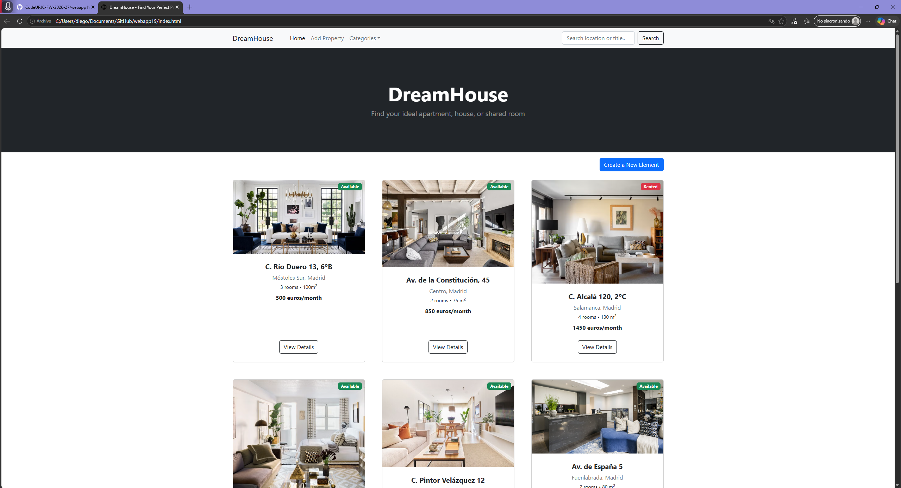
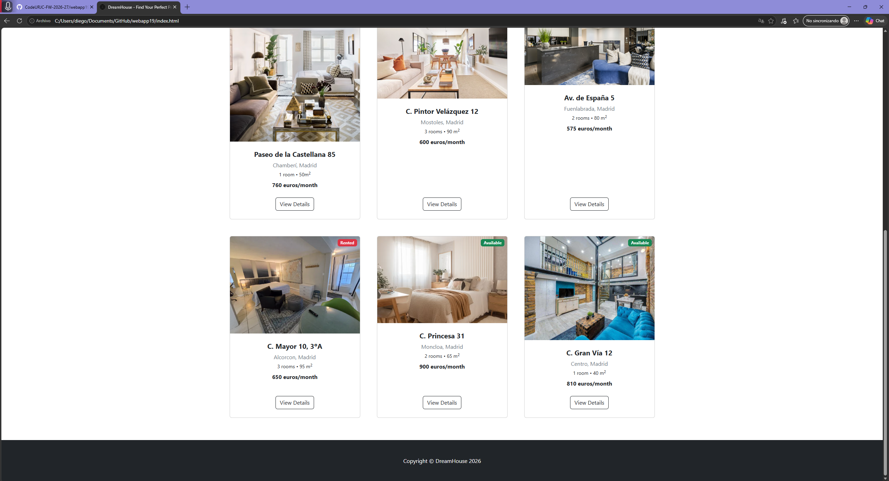
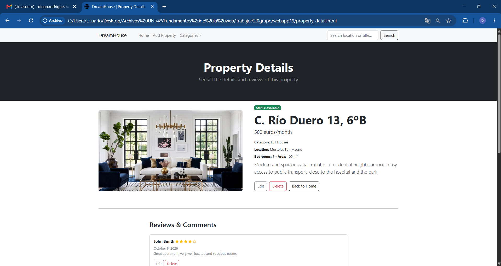
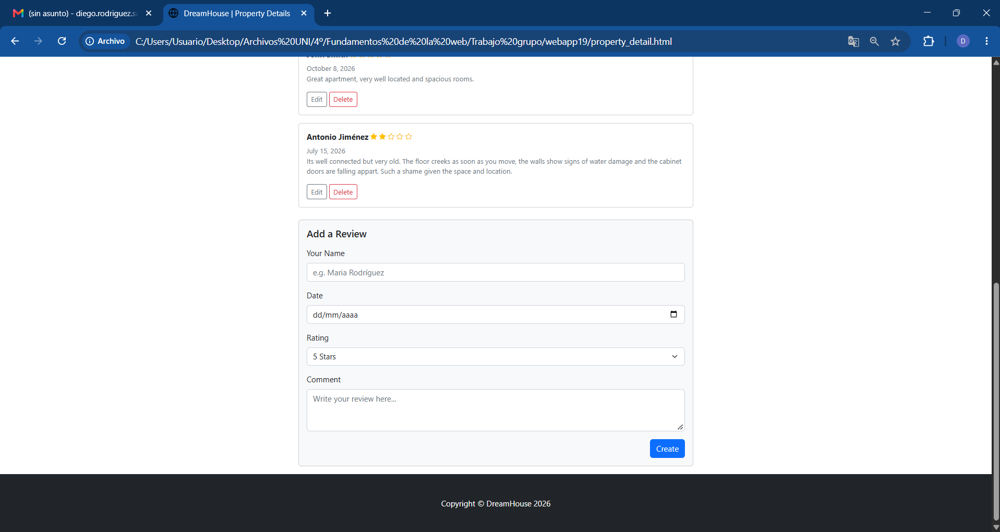
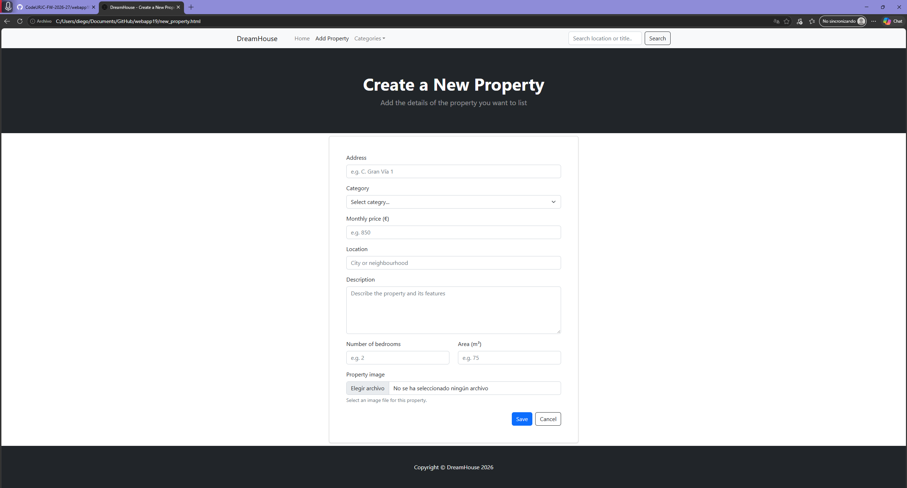
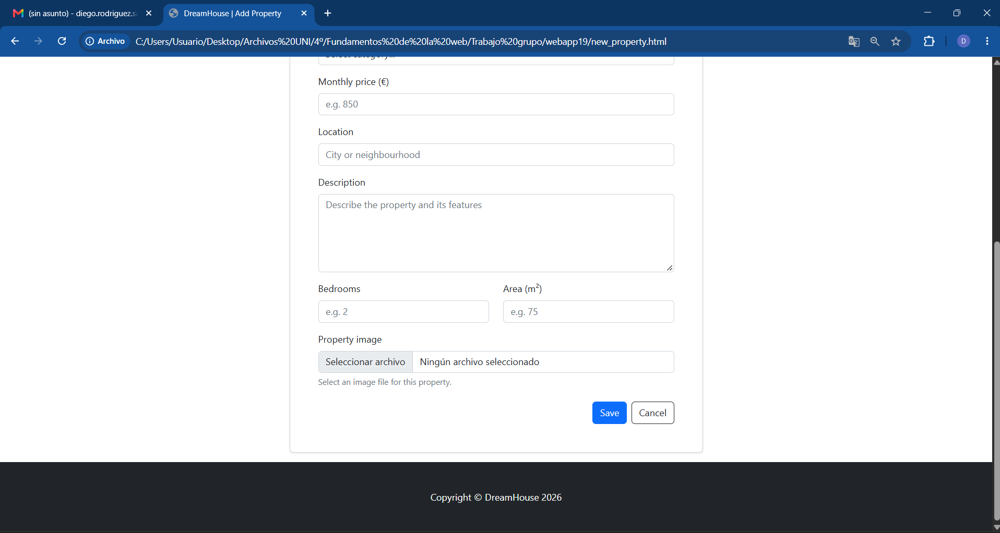

# webapp19
# Housing Rental Web

## Team Members

| Name | Surname | Official University Email | GitHub Account |
| :--- | :--- | :--- | :--- |
| Paula | Sánchez Garduño | p.sanchezg.2023@alumnos.urjc.es | paulasanchez4 |
| Diego | Rodríguez Salinas| d.rodriguezs.2023@alumnos.urjc.es | diieegorodriguezz |
| Rodrigo | Fernández de Córdoba García | r.fernandezgar.2023@alumnos.urjc.es | RodrigoFDCG |
| Enrique | Aldama Moradillo | e.aldama.2023@alumnos.urjc.es | EnriqueAldama |

* **Trello Board / Coordination Tool:** https://trello.com/b/ERNrTVPC/housing-rental-web

---

## Functionality

### Entities

* **Main Entity: Property**
  * Description: Represents a real estate property (apartment or house) available for rent, displaying its main details.
  * Attributes:
    * `title` (String): Title of the property listing (must start with an uppercase letter and be unique).
    * `price` (Number): Price in euros (rent per month).
    * `location` (String): City or neighborhood where the property is located.
    * `description` (String): Detailed description of the property features.
    * `bedrooms` (Number): Number of bedrooms in the property.
    * `area` (Number): Total area of the property in square meters.

* **Secondary Entity: Review**
  * Description: Represents comments, ratings, and feedback left by users regarding a specific property.
  * Attributes:
    * `author` (String): Name or username of the person writing the review.
    * `rating` (Number): Score given to the property (e.g., from 1 to 5 stars).
    * `comment` (String): Detailed text opinion or feedback about the property.
    * `date` (String): Date when the review was posted.

### Images

* Each **Property** entity will have one or more associated images (photographs of the apartment or house) uploaded directly from the web browser.
* **Review** entities focus primarily on text comments and ratings.

### Search, Filtering, and Categorization
* **Search Engine**: A text input box allowing users to search for properties whose title or location contains the specified query string.
* **Categorization:** Properties are categorized by price ranges, location zones, or the number of rooms, accessible from the navigation menu. 

## PRACTICE 1

### Screenshots

These are the screenshots for the 3 parts required:

#### Home page




#### Property detail page





#### New property page





### Member participation in practice 1

#### Participation of Paula Sánchez Garduño

**Description of tasks performed:**

* For this initial task, I was responsible for establishing the entire structural and visual foundation of the web application using HTML and CSS. I began by defining the semantic structure of the main page and setting up the basic navigation bar. Next, I downloaded and adapted a Bootstrap template, integrating its grid system to ensure a responsive design. Once that foundation was in place, I populated the catalog by adding details for eight of the nine required properties, thereby completing the home page. I also worked on the individual property pages, structuring the section dedicated to the secondary entity. Finally, I finished the property creation form by standardizing the header and including the category selector, thus meeting one of the key requirements.

**The 5 most significant commits:**
* [Setup semantic HTML structure and navigation for index page](https://github.com/CodeURJC-FW-2026-27/webapp19/commit/b4e3e33dd107cfdf9caefb967acce4816412545b): I’ve prepared the HTML "skeleton" and the navigation here before applying the styles.
* [Integrate Bootstrap template and layout into index.html](https://github.com/CodeURJC-FW-2026-27/webapp19/commit/eae3f26d54dc9476fe79eb575a57174cf4a32601): 
That was where I integrated the Bootstrap template into the project to start shaping the interface.
* [Add secondary entity to property_detail.html](https://github.com/CodeURJC-FW-2026-27/webapp19/commit/0a8c3330dd87e319943f295cad0ec7e5f9f72f5e): 
In this commit, I defined the view for the secondary entity within the property details.
* [Add complete details for remaining 8 properties](https://github.com/CodeURJC-FW-2026-27/webapp19/commit/4ee713b57385a37e9dd76bb17a2d5b238429d772)
Complete the cover page to finalize the grid with all the test elements.
* [Add category select form field and fix navbar active link](https://github.com/CodeURJC-FW-2026-27/webapp19/commit/30a16aa947d57ad14f0dba4b72e926aa0ed230b4)
Where I added the dropdown menu to the form to categorize the properties.

**The 5 files I have contributed to the most:**
* [`index.html`](https://github.com/CodeURJC-FW-2026-27/webapp19/blob/main/index.html): 
Where I set up the semantic HTML and the Bootstrap template, and filled in the cover page properties.
* [`property_detail.html`](https://github.com/CodeURJC-FW-2026-27/webapp19/blob/main/property_detail.html)
Where I set up the individual view and added the secondary entity block.
* [`new_property.html`](https://github.com/CodeURJC-FW-2026-27/webapp19/blob/main/new_property.html)
Where I adjusted the form by adding the category selector and unified the menu.
* [`style.css`](https://github.com/CodeURJC-FW-2026-27/webapp19/blob/main/css/styles.css)
For the additional style adjustments I had to make to the template.
* [`README.md`](https://github.com/CodeURJC-FW-2026-27/webapp19/blob/main/README.md)
Where I added the initial configuration and the link to Trello, and documented my part of the work.

#### Participation of Diego Rodríguez Salinas

**Description of tasks performed:**

* For this part of the project, I updated the documentation to include the `rooms` and `area` attributes of the `Property` entity and added the number of rooms as a categorization option. I also populated the home page with sample property names. Finally, I created the property creation page and its form, including fields for the title, price, location, description, number of rooms, area, and image, as well as Save and Cancel actions.

**The most significant commits:**

* [Entities update](https://github.com/CodeURJC-FW-2026-27/webapp19/commit/39266c9a76e7df633f2bed9a2c162cf2a6537aa7): In this commit, I added the `rooms` and `area` attributes to the `Property` entity and updated the categorization description to include the number of rooms.
* [Populate main page with sample items](https://github.com/CodeURJC-FW-2026-27/webapp19/commit/1fbd23cb88488cf92e206ca9fc152dcc6603bb6c): In this commit, I replaced the placeholder titles on the nine property cards with sample property names, so the home page displays example listings.
* [Update new_property.html](https://github.com/CodeURJC-FW-2026-27/webapp19/commit/a8c91b5725649ac52e894f128f767f40392a6e90): In this commit, I created the property creation page from scratch. I added the page navigation and heading, then built a responsive Bootstrap form with fields for the title, price, location, description, number of rooms, area, and property image. I also added Save and Cancel actions, with Cancel linking back to the home page.
* [Unify shared terminology and page metadata](https://github.com/CodeURJC-FW-2026-27/webapp19/commit/0ee6ea6): In this commit, I unified page titles and property terminology, removed empty metadata and template favicons, updated category links and image alt text, and added missing section comments to the property detail page.
* [Little fixes](https://github.com/CodeURJC-FW-2026-27/webapp19/commit/170494bb68cf8037f922808943696dfb74a6431c): Fixed duplicated property detail images and data, aligned the area with the home page, and applied cover cropping to the detail image.
* [Format HTML files](https://github.com/CodeURJC-FW-2026-27/webapp19/commit/a52850fec85bb1fef717c05bd980ae49915a1791): Reformatted the three HTML files in VS Code for consistent spacing, indentation, and line wrapping without changing their content.

**The files I have contributed to:**

* [`README.md`](https://github.com/CodeURJC-FW-2026-27/webapp19/blob/main/README.md): Documented the Property attributes and categorization by number of rooms.
* [`index.html`](https://github.com/CodeURJC-FW-2026-27/webapp19/blob/main/index.html): Added sample titles for the property cards on the home page.
* [`new_property.html`](https://github.com/CodeURJC-FW-2026-27/webapp19/blob/main/new_property.html): Created the property form and its page layout.
* [`property_detail.html`](https://github.com/CodeURJC-FW-2026-27/webapp19/blob/main/property_detail.html): Fixed the duplicated property image and details, corrected the area to match the home page, and applied cover cropping.

#### Participation of Rodrigo Fernández de Córdoba García
* In this phase of the project, I mostly focused on the entity page. In the first part, when deciding the theme and structure, I proposed the theme and filters for the page. For the rest of the project I focused on creating the secondary entity page, adapting it to the template and fixing other CSS issues. The commits made were only 2, but the focus was on having each commit deliver a finished part instead of non functional pieces

**The most significant commits:**

* [Primary entity detail page](https://github.com/CodeURJC-FW-2026-27/webapp19/commit/cb9457a09e986785bbe1b1e8997e2798a8cce608): This commit includes the first version of the detail page for apartments, with all of the fields, header and footer (except reviews) and already adapted to the template.

* [CSS fixes and second review](https://github.com/CodeURJC-FW-2026-27/webapp19/commit/26671dde3c7190757707354aa0dc5421d132a8af): Added a second review and fixed CSS and issues mostly related to difference between screen sizes.

**The files I have contributed to:**

* [`index.html`](https://github.com/CodeURJC-FW-2026-27/webapp19/blob/main/index.html): Fixed CSS issues
* [`property_detail.html](https://github.com/CodeURJC-FW-2026-27/webapp19/blob/main/new_property.html): Created the page and adapted it to the template

#### Participation of Enrique Aldama Moradillo

**Description of tasks performed:**

* I fixed style, consistency and form issues in the three pages. I created `css/custom.css` for the project's own styles, linked it in all pages and gave all property card images the same height. I replaced the inline styles of the status badges with Bootstrap utilities. In the detail page, I added the shared header and the property category, fixed the size of property 1, replaced wrong Bootstrap classes, unified the style and order of the action buttons and aligned the review form with the property form. In the new property page, I fixed the category typo, added validation limits to the price, area and description fields and increased the spacing between the header and the form.

**The 5 most significant commits:**

* [Add custom stylesheet with uniform card image height](https://github.com/CodeURJC-FW-2026-27/webapp19/commit/9a1129e812716450058d29a15f44160f78b2468d): I created `css/custom.css`, linked it in the three pages and set the same height for all card images with `object-fit: cover`. I also changed the detail image from `card-img-top` to `img-fluid rounded`, because it is not inside a card.
* [Replace inline badge styles with Bootstrap position utilities](https://github.com/CodeURJC-FW-2026-27/webapp19/commit/2038ca0f6334f5eb774fe299cd101fd3bc23a6d5): I removed the inline styles of the 9 status badges and used the Bootstrap classes `top-0 end-0 m-2` instead.
* [Add shared dark header to property detail page](https://github.com/CodeURJC-FW-2026-27/webapp19/commit/2508d7116b3bc6e69d353ed64180615e2566ff41): I added the dark header used in the other pages, so all pages share the same header and footer.
* [Show category and fix size of property on detail page](https://github.com/CodeURJC-FW-2026-27/webapp19/commit/8861a5b8cdf3b21bdd471758e2d4d85305b86c7c): I added the category to the property details and changed the size of property 1 from 120 m² to 100 m², the value shown on its card.
* [Fix review date classes and align review form with property form](https://github.com/CodeURJC-FW-2026-27/webapp19/commit/494922f9743fa73d2916d43ae630777ae1a28528): I replaced `text-left` with `text-start d-block` in the review dates. In the review form, I right-aligned the *Create* button and added `name` attributes and `review`-prefixed ids to the fields.

**The 5 files I have contributed to the most:**

* [`property_detail.html`](https://github.com/CodeURJC-FW-2026-27/webapp19/blob/main/property_detail.html): I added the header and the category, fixed the size of property 1, the Bootstrap classes and the action buttons, and updated the review form.
* [`index.html`](https://github.com/CodeURJC-FW-2026-27/webapp19/blob/main/index.html): I linked `custom.css` and replaced the inline badge styles with Bootstrap utilities.
* [`new_property.html`](https://github.com/CodeURJC-FW-2026-27/webapp19/blob/main/new_property.html): I linked `custom.css`, fixed the category typo, added validation limits to price, area and description, and increased the spacing between the header and the form.
* [`custom.css`](https://github.com/CodeURJC-FW-2026-27/webapp19/blob/main/css/custom.css): I created this file for the project's own styles (same height for all card images).
* [`README.md`](https://github.com/CodeURJC-FW-2026-27/webapp19/blob/main/README.md): I documented my participation.

## PRACTICE 2
**Demo video:** https://youtu.be/gKMw7ZnqBAw

### Execution Instructions

#### Requirements
- **Node.js** (v18 or higher) and **npm**
- **MongoDB** (v6 or higher) running locally on `127.0.0.1:27017`

### Download, Build and Run
1. Clone the repository and enter the project directory:
```bash
git clone [https://github.com/CodeURJC-FW-2026-27/webapp19.git](https://github.com/CodeURJC-FW-2026-27/webapp19.git)
cd webapp19
```
2. Start MongoDB (it must be running at `127.0.0.1:27017`).
3. Install the dependencies and start the server:

```bash
npm install
npm start
```

4. Open http://localhost:3000 in the browser.

The first time the application starts, it inserts 9 sample properties with their reviews into the `dreamhouse` database and copies the images from `data/` to `uploads/`.

### File Descriptions

- **[`src/app.js`](https://github.com/CodeURJC-FW-2026-27/webapp19/blob/main/src/app.js)**: Entry point of the Express server. Configures Mustache as the template engine, serves static files (`public/` and `/uploads`), registers the router, and starts listening on port 3000 after connecting to MongoDB.
- **[`src/db.js`](https://github.com/CodeURJC-FW-2026-27/webapp19/blob/main/src/db.js)**: Connects to the MongoDB `dreamhouse` database, creates the `uploads/` folder if needed, copies the initial sample images from `data/` to `uploads/` on startup, and seeds 9 sample properties and reviews when the collection is empty.
- **[`src/router.js`](https://github.com/CodeURJC-FW-2026-27/webapp19/blob/main/src/router.js)**: Defines all application routes, server-side pagination (6 properties per page), text search and category filtering, Multer image upload and cleanup logic, server-side validations, and creation, editing, and deletion operations for both properties and reviews.
- **[`views/header.html`](https://github.com/CodeURJC-FW-2026-27/webapp19/blob/main/views/header.html)**: Reusable Mustache partial containing the navigation bar, category filter menu, and search bar.
- **[`views/footer.html`](https://github.com/CodeURJC-FW-2026-27/webapp19/blob/main/views/footer.html)**: Reusable Mustache partial containing the page footer.
- **[`views/index.html`](https://github.com/CodeURJC-FW-2026-27/webapp19/blob/main/views/index.html)**: Dynamic Mustache template for the home catalog displaying property cards and server-side pagination controls.
- **[`views/property_detail.html`](https://github.com/CodeURJC-FW-2026-27/webapp19/blob/main/views/property_detail.html)**: Dynamic Mustache template displaying all details of a property, edit/delete action buttons, existing reviews with dynamic star ratings, and the form to add a new review.
- **[`views/new_property.html`](https://github.com/CodeURJC-FW-2026-27/webapp19/blob/main/views/new_property.html)**: Reusable Mustache form template used both to create a new property and to edit an existing one.
- **[`views/edit_review.html`](https://github.com/CodeURJC-FW-2026-27/webapp19/blob/main/views/edit_review.html)**: Mustache template containing a prefilled form to edit an existing review.
- **[`views/confirmation.html`](https://github.com/CodeURJC-FW-2026-27/webapp19/blob/main/views/confirmation.html)**: Reusable confirmation page displayed after creating, editing, or deleting a property or review.
- **[`views/error.html`](https://github.com/CodeURJC-FW-2026-27/webapp19/blob/main/views/error.html)**: Reusable error page displayed when server-side validation or database errors occur.
- **[`public/css/custom.css`](https://github.com/CodeURJC-FW-2026-27/webapp19/blob/main/public/css/custom.css)**: Custom CSS rules for uniform property card image heights and layout refinements.
- **[`public/css/styles.css`](https://github.com/CodeURJC-FW-2026-27/webapp19/blob/main/public/css/styles.css)**: Base Bootstrap template styles adapted for the web application.
- **[`public/js/scripts.js`](https://github.com/CodeURJC-FW-2026-27/webapp19/blob/main/public/js/scripts.js)**: Client-side JavaScript scripts from the Bootstrap template.
- **[`data/`](https://github.com/CodeURJC-FW-2026-27/webapp19/tree/main/data)**: Directory containing the initial sample property images (`property1.jpg` to `property9.jpg`) copied to `uploads/` on startup.
- **`uploads/`**: Runtime directory where uploaded and active property images are stored and served from `/uploads` (excluded from Git).
- **[`.gitignore`](https://github.com/CodeURJC-FW-2026-27/webapp19/blob/main/.gitignore)**: Specifies files and directories excluded from version control (`node_modules/`, `uploads/`, `.DS_Store`).

### Demo steps

1. **Home page and pagination:** open `/`. 6 properties are shown per page; use the page numbers and the Previous/Next buttons to go to page 2.
2. **Search:** type "Madrid" or "Gran" in the search box and press Search. Go to the next page of results to check that the search is kept.
3. **Categories:** open the Categories menu and choose Rooms, Full Houses or Shared Apartments.
4. **Property detail:** click View Details on any property to see all its data, its image and its reviews. The property "C. Gran Vía 12" has no reviews.
5. **Create a property:** click Create a New Property, fill the form and save. Then try to save a title that already exists or that starts with a lowercase letter (remove the browser validations from the DOM first) to see the error page.
6. **Edit a property:** in the detail page click Edit, change some fields and the image, and save. A confirmation page is shown.
7. **Add a review:** in the detail page fill the Add a Review form and press Create. Try to add a second review with the same author to see the error page.
8. **Edit and delete a review:** use the Edit and Delete buttons of a review.
9. **Delete a property:** in the detail page press Delete. A confirmation page is shown and the property disappears from the home page.

### Member participation in practice 2
#### Participation of Paula Sánchez Garduño

**Description of tasks performed:**
* During Practice 2, I was responsible for setting up the server architecture and migrating the static frontend into a dynamic Node.js and Express web application connected to MongoDB. I restructured the project folders (`src/`, `views/`, `public/`), configured Mustache templates along with reusable partials (`header.html`, `footer.html`, `confirmation.html`, and `error.html`), and updated the data models to named ESM exports. On the backend, I implemented server-side pagination (6 items per page), full search and category filtering in the main route, and the complete creation, editing, deletion, and server-side validation logic for both properties and reviews. Finally, I configured Multer to handle image uploads into the `uploads/` folder and updated `db.js` to automatically seed sample reviews and copy initial property images on startup.

**The 5 most significant commits:**
* [Refactor project structure and setup Express server with static files support](https://github.com/CodeURJC-FW-2026-27/webapp19/commit/e292ae94c535a491bef84e4a54a6e57b4ffcd079): Reorganized the repository structure and configured the Express server with Mustache rendering and static asset serving.
* [Implement server-side pagination logic in router](https://github.com/CodeURJC-FW-2026-27/webapp19/commit/8e881fbd5ff97c38d0d3febe1383c3954d50c8ab): Added backend pagination logic in `router.js` to display 6 properties per page and generate page navigation links.
* [Implement dynamic stars rendering and review comment creation route](https://github.com/CodeURJC-FW-2026-27/webapp19/commit/f51f49c89ff1770d522a733a9d3c3a8e2bc96cce): Built the dynamic star-rating mapping for Mustache and the POST route to store new property reviews in MongoDB.
* [Implement CRUD routes, validation, search/filter, and image handling for properties and reviews](https://github.com/CodeURJC-FW-2026-27/webapp19/commit/ed8da53d2c0c20995f5fd05d23c136dd4fc0477d): Implemented full creation, editing, deletion, server-side validation, and image cleanup logic for both main and secondary entities.
* [Add search and category filtering with pagination support in main route](https://github.com/CodeURJC-FW-2026-27/webapp19/commit/c02500106430e4e52cc2be8515d4612db2b0cbea): Integrated text search and category filtering in the home route while keeping active query parameters across pagination links.

**The 5 files I have contributed to the most:**
* [src/router.js](https://github.com/CodeURJC-FW-2026-27/webapp19/blob/main/src/router.js): Implemented all application routes, pagination, search and category filtering, Multer image handling, server-side validations, and full create/edit/delete operations for properties and reviews.
* [views/index.html](https://github.com/CodeURJC-FW-2026-27/webapp19/blob/main/views/index.html): Converted the home catalog into a dynamic Mustache view and integrated the server-side pagination UI controls.
* [views/property_detail.html](https://github.com/CodeURJC-FW-2026-27/webapp19/blob/main/views/property_detail.html): Integrated dynamic Mustache fields, dynamic star ratings, action buttons, and the review submission section.
* [src/db.js](https://github.com/CodeURJC-FW-2026-27/webapp19/blob/main/src/db.js): Standardized connection logs in English, seeded initial sample reviews on properties, and added startup logic to copy sample images into `uploads/`.
* [views/header.html](https://github.com/CodeURJC-FW-2026-27/webapp19/blob/main/views/header.html): Extracted the navigation bar as a reusable Mustache partial and connected the search bar and category links to the backend filters.

#### Participation of Diego Rodríguez Salinas

**Description of tasks performed:**
* During Practice 2, I implemented the property creation and editing flows using a reusable form. I added server-side validation, handled uploaded images, and ensured that editing a property kept its current image when no replacement was selected. I also implemented review editing, connected the review edit and delete buttons, and added validation to prevent the same author from submitting multiple reviews for one property.

**The 5 most significant commits:**
* [Complete property creation and reusable form](https://github.com/CodeURJC-FW-2026-27/webapp19/commit/885f779a09772ee084993458781911faa8800675): Reused the property form for creation and editing and connected server-side validation with image upload handling.
* [Align property editing with the current schema](https://github.com/CodeURJC-FW-2026-27/webapp19/commit/108d7cfec9f183d35fba82311fa394a2bb045866): Updated property editing to use the current fields and categories, while preserving or replacing the property image as appropriate.
* [Add review validation and edit form](https://github.com/CodeURJC-FW-2026-27/webapp19/commit/78090cb3dbbbb3ae2d222225eec42c39a505a20c): Added review validation and created a form prefilled with the review being edited.
* [Connect review edit and delete buttons](https://github.com/CodeURJC-FW-2026-27/webapp19/commit/e986506e295f357cafd71754e51e2e0df133e303): Connected the review edit and delete controls on the property detail page to their server routes.
* [Fix duplicated authors in reviews](https://github.com/CodeURJC-FW-2026-27/webapp19/commit/c8c65c696da0bf08046dd9901467211e4be28f5b): Prevented an author from submitting more than one review for the same property.

**The 5 files I have contributed to the most:**
* [src/router.js](https://github.com/CodeURJC-FW-2026-27/webapp19/blob/main/src/router.js): Added property creation and editing validation, review validation and routes, and image handling for property updates.
* [views/new_property.html](https://github.com/CodeURJC-FW-2026-27/webapp19/blob/main/views/new_property.html): Adapted the property form to support both creating and editing a property.
* [views/edit_comment.html](https://github.com/CodeURJC-FW-2026-27/webapp19/blob/main/views/edit_comment.html): Created the form for editing an existing review.
* [views/property_detail.html](https://github.com/CodeURJC-FW-2026-27/webapp19/blob/main/views/property_detail.html): Connected the review edit and delete buttons to their routes.
* [README.md](https://github.com/CodeURJC-FW-2026-27/webapp19/blob/main/README.md): Documented my Practice 2 tasks and linked my most significant commits.

#### Participation of Enrique Aldama Moradillo

**Description of tasks performed:**

* In practice 2, I fixed the connection to MongoDB and cleaned the project so it follows the requirements of the assignment. I moved the sample images to the `data/` folder, which are copied to `uploads/` when the application starts, and I made the images be served from `/uploads`. I fixed the header and footer partials and gave every view, including the confirmation and error pages, the same `<head>`. I fixed the pagination links so they keep the search and the category, and the active menu item. I also improved the validations (length limits in the review form, check that the uploaded file is an image) and unified the names of the review fields. Finally, I removed duplicated code in `router.js` with the `renderError` and `renderConfirmation` functions, simplified the validations and prepared the demo data, the demo steps and the README.

**The 5 most significant commits:**

* [Fix MongoDB connection and remove mongoose](https://github.com/CodeURJC-FW-2026-27/webapp19/commit/e9624ffd1802ea7c0acb948cec7a7e0dac6a6324): The application waits for `connectDB()` before listening, `Property` is assigned correctly and mongoose is removed from `package.json` and the lock file.
* [Move images to data/ and serve from uploads](https://github.com/CodeURJC-FW-2026-27/webapp19/commit/9c20fdb773022a6c0dd5d0ff4e700cdf2f247a15): The sample images are in `data/` and are copied to `uploads/` on startup with a loop. The views load the images from `/uploads`.
* [Fix header and footer partials, add head to views](https://github.com/CodeURJC-FW-2026-27/webapp19/commit/55893334b7a22c0c00fd5c7dbe24c02505146932): `header.html` only has the navbar and the banner, `footer.html` has the footer and the scripts, and each view has its own `<head>`.
* [Remove duplicated code and unify property and review names](https://github.com/CodeURJC-FW-2026-27/webapp19/commit/3a88eba2e6337bb31af09a19e2e0eef08873cd29): Rewrote `router.js` with shared functions for errors, confirmations and validations.
* [Add varied demo data and demo steps to README](https://github.com/CodeURJC-FW-2026-27/webapp19/commit/ee1e0fe9a227ff73bb0c6449d94d6976054ab490): Each property has different sample reviews and the README explains how to run and demo the application.

**The 5 files I have contributed to the most:**

* [src/router.js](https://github.com/CodeURJC-FW-2026-27/webapp19/blob/main/src/router.js): Shared error and confirmation functions, simplified validations and review routes.
* [src/db.js](https://github.com/CodeURJC-FW-2026-27/webapp19/blob/main/src/db.js): Connection fix, copy of the images from `data/` and varied sample data.
* [views/header.html](https://github.com/CodeURJC-FW-2026-27/webapp19/blob/main/views/header.html): Header partial with only the navbar and the banner.
* [views/index.html](https://github.com/CodeURJC-FW-2026-27/webapp19/blob/main/views/index.html): Pagination links that keep the search and the category.
* [README.md](https://github.com/CodeURJC-FW-2026-27/webapp19/blob/main/README.md): Run instructions, demo steps and my participation.

#### Participation of Rodrigo Fernández de Córdoba García
**Description of tasks performed:**
During this phase I was responsible of setting up the common headers and footers to be used with mustache, setting up the database, migrating from mongoose to mongoDB, creating the property creation and edition backend, creating the example entities and fixing any remaining errors or broken code.

**The 5 most significant commits:**
* [Changed, package.json y package-lock.json to use mongoDB instead of mongoose](https://github.com/CodeURJC-FW-2026-27/webapp19/commit/0ec8a9e67cc77b38b5878259d3952c967a10b5ce): Changed the project to use MongoDB instead of MongoDB with Mongoose to follow the subjects guidelines
* [New property backend added](https://github.com/CodeURJC-FW-2026-27/webapp19/commit/7fe6d44fc5c2e6b0a4a947f5670088084699f2f1): Added the functions to create a new property using the creation form
* [Changed the error with routes in the header and images, added the remaining properties and property fields to db](https://github.com/CodeURJC-FW-2026-27/webapp19/commit/6846c5608758b48a4599692cbe65a9145185066c): Fixed the errors with routes that broke the app and added the examples to the database initialization
* [separated the header and added comments as a schema for the db](https://github.com/CodeURJC-FW-2026-27/webapp19/commit/9dff9b9f6f9c96c60531a990912816df4b258e7e): Separated header to be inserted into every page with mustache and declared the schema of the secondary entities (comments) in db.js

**The 5 files I have contributed to the most:**

* [src/router.js](https://github.com/CodeURJC-FW-2026-27/webapp19/blob/main/src/router.js): Simplified functions, adapted it to the MongoDB syntax, added property creation and viewing and fixed the broken arguments
* [src/db.js](https://github.com/CodeURJC-FW-2026-27/webapp19/blob/main/src/db.js): Added the examples, updated to mongoDB and added property creation
* [views/header.html](https://github.com/CodeURJC-FW-2026-27/webapp19/blob/main/views/header.html): Created the header from other pages headers
* [views/index.html](https://github.com/CodeURJC-FW-2026-27/webapp19/blob/main/views/index.html): Fixed the broken links
* [views/new_property.html](https://github.com/CodeURJC-FW-2026-27/webapp19/blob/main/new_property.html): Fixed the broken arguments that made it so validation failed
