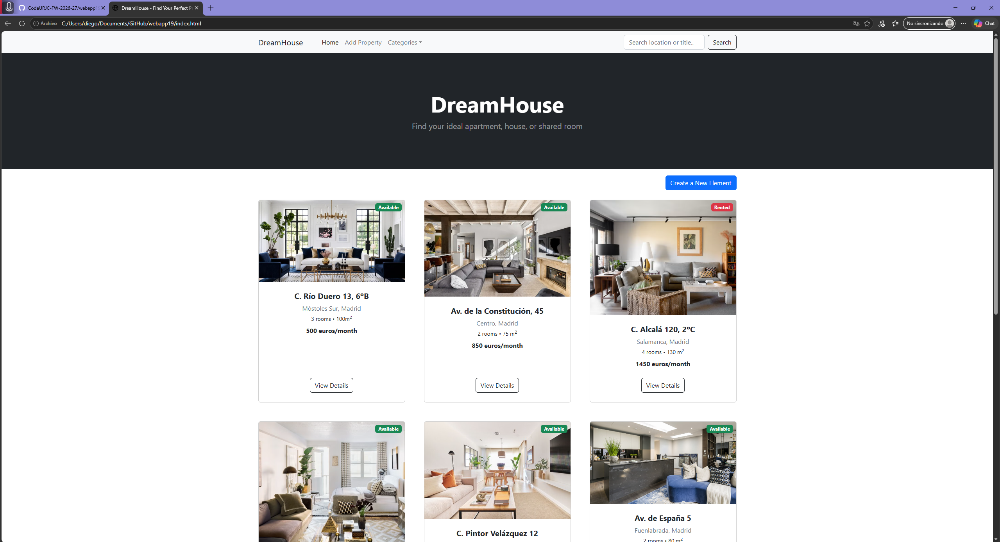
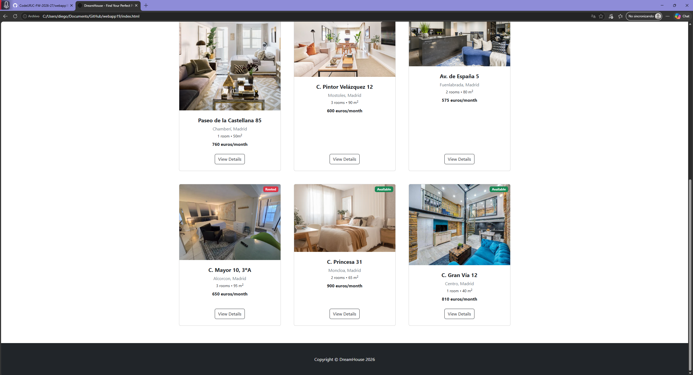
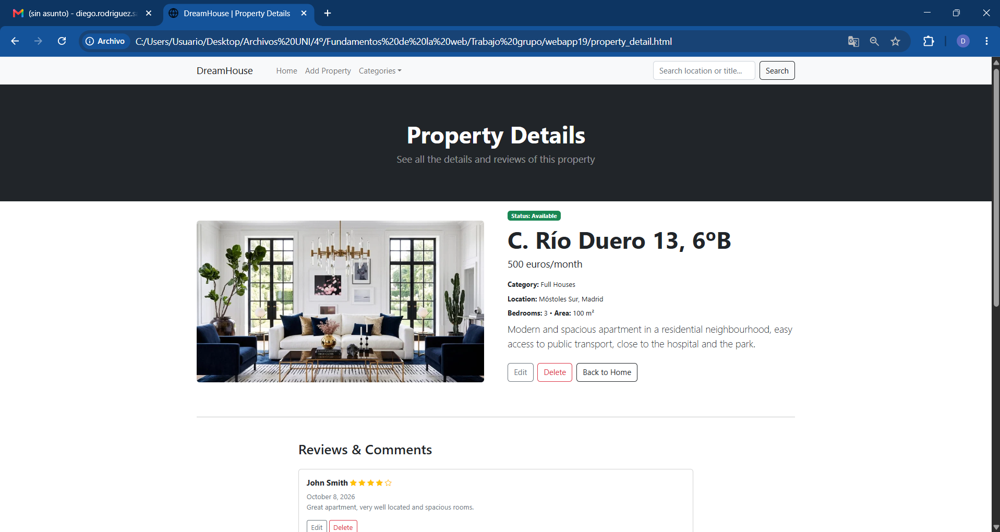
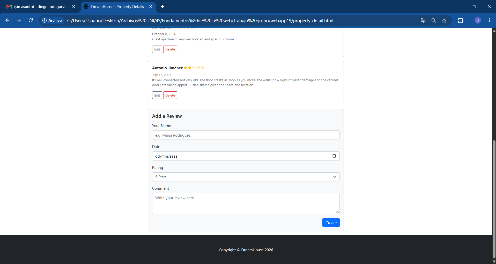
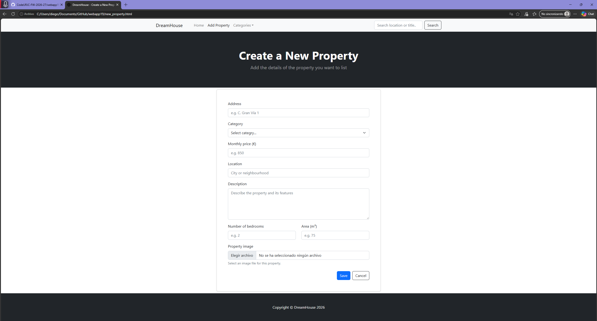
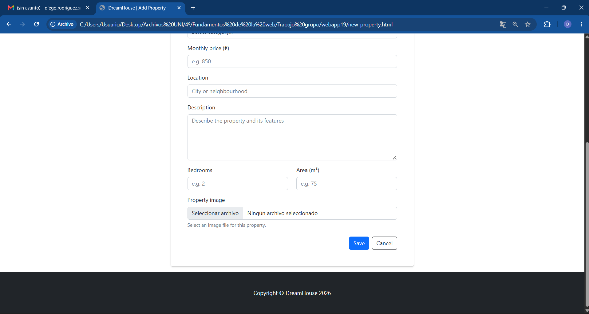

# webapp19
# Housing Rental Web

## Team Members

| Name | Surname | Official University Email | GitHub Account |
| :--- | :--- | :--- | :--- |
| Paula | Sánchez Garduño | p.sanchezg.2023@alumnos.urjc.es | paulasanchez4 |
| Diego | Rodríguez Salinas| d.rodriguezs.2023@alumnos.urjc.es | diieegorodriguezz |
| Rodrigo | Fernández de Córdoba García | r.fernandezgar.2023@alumnos.urjc.es | RodrigoFDCG |
| Enrique | Aldama Moradillo | e.aldama.2023@alumnos.urjc.es | EnriqueAldama |

* **Trello Board / Coordination Tool:** https://trello.com/b/ERNrTVPC/housing-rental-web

---

## Functionality

### Entities

* **Main Entity: Property**
  * Description: Represents a real estate property (apartment or house) available for rent, displaying its main details.
  * Attributes:
    * `title` (String): Title of the property listing (must start with an uppercase letter and be unique).
    * `price` (Number): Price in euros (rent per month).
    * `location` (String): City or neighborhood where the property is located.
    * `description` (String): Detailed description of the property features.
    * `rooms` (Number): Number of bedrooms in the property.
    * `area` (Number): Total area of the property in square meters.

* **Secondary Entity: Review**
  * Description: Represents comments, ratings, and feedback left by users regarding a specific property.
  * Attributes:
    * `author` (String): Name or username of the person writing the review.
    * `rating` (Number): Score given to the property (e.g., from 1 to 5 stars).
    * `comment` (String): Detailed text opinion or feedback about the property.
    * `date` (String): Date when the review was posted.

### Images

* Each **Property** entity will have one or more associated images (photographs of the apartment or house) uploaded directly from the web browser.
* **Review** entities focus primarily on text comments and ratings.

### Search, Filtering, and Categorization
* **Search Engine**: A text input box allowing users to search for properties whose title or location contains the specified query string.
* **Categorization:** Properties are categorized by price ranges, location zones, or the number of rooms, accessible from the navigation menu. 

## Practice 1

### Screenshots

These are the screenshots for the 3 parts required:

#### Home page

#### Property detail page

#### New property page

### Member participation

#### Participation of Paula Sánchez Garduño

**Description of tasks performed:**

* For this initial task, I was responsible for establishing the entire structural and visual foundation of the web application using HTML and CSS. I began by defining the semantic structure of the main page and setting up the basic navigation bar. Next, I downloaded and adapted a Bootstrap template, integrating its grid system to ensure a responsive design. Once that foundation was in place, I populated the catalog by adding details for eight of the nine required properties, thereby completing the home page. I also worked on the individual property pages, structuring the section dedicated to the secondary entity. Finally, I finished the property creation form by standardizing the header and including the category selector, thus meeting one of the key requirements.

**The 5 most significant commits:**
* [Setup semantic HTML structure and navigation for index page](https://github.com/CodeURJC-FW-2026-27/webapp19/commit/b4e3e33dd107cfdf9caefb967acce4816412545b): I’ve prepared the HTML "skeleton" and the navigation here before applying the styles.
* [Integrate Bootstrap template and layout into index.html](https://github.com/CodeURJC-FW-2026-27/webapp19/commit/eae3f26d54dc9476fe79eb575a57174cf4a32601): 
That was where I integrated the Bootstrap template into the project to start shaping the interface.
* [Add secondary entity to property_detail.html](https://github.com/CodeURJC-FW-2026-27/webapp19/commit/0a8c3330dd87e319943f295cad0ec7e5f9f72f5e): 
In this commit, I defined the view for the secondary entity within the property details.
* [Add complete details for remaining 8 properties](https://github.com/CodeURJC-FW-2026-27/webapp19/commit/4ee713b57385a37e9dd76bb17a2d5b238429d772)
Complete the cover page to finalize the grid with all the test elements.
* [Add category select form field and fix navbar active link](https://github.com/CodeURJC-FW-2026-27/webapp19/commit/30a16aa947d57ad14f0dba4b72e926aa0ed230b4)
Where I added the dropdown menu to the form to categorize the properties.

**The 5 files I have contributed to the most:**
* [`index.html`](https://github.com/CodeURJC-FW-2026-27/webapp19/blob/main/index.html): 
Where I set up the semantic HTML and the Bootstrap template, and filled in the cover page properties.
* [`property_detail.html`](https://github.com/CodeURJC-FW-2026-27/webapp19/blob/main/property_detail.html)
Where I set up the individual view and added the secondary entity block.
* [`new_property.html`](https://github.com/CodeURJC-FW-2026-27/webapp19/blob/main/new_property.html)
Where I adjusted the form by adding the category selector and unified the menu.
* [`style.css`](https://github.com/CodeURJC-FW-2026-27/webapp19/blob/main/css/styles.css)
For the additional style adjustments I had to make to the template.
* [`README.md`](https://github.com/CodeURJC-FW-2026-27/webapp19/blob/main/README.md)
Where I added the initial configuration and the link to Trello, and documented my part of the work.

#### Participation of Diego Rodríguez Salinas

**Description of tasks performed:**

* For this part of the project, I updated the documentation to include the `rooms` and `area` attributes of the `Property` entity and added the number of rooms as a categorization option. I also populated the home page with sample property names. Finally, I created the property creation page and its form, including fields for the title, price, location, description, number of rooms, area, and image, as well as Save and Cancel actions.

**The most significant commits:**

* [Entities update](https://github.com/CodeURJC-FW-2026-27/webapp19/commit/39266c9a76e7df633f2bed9a2c162cf2a6537aa7): In this commit, I added the `rooms` and `area` attributes to the `Property` entity and updated the categorization description to include the number of rooms.
* [Populate main page with sample items](https://github.com/CodeURJC-FW-2026-27/webapp19/commit/1fbd23cb88488cf92e206ca9fc152dcc6603bb6c): In this commit, I replaced the placeholder titles on the nine property cards with sample property names, so the home page displays example listings.
* [Update new_property.html](https://github.com/CodeURJC-FW-2026-27/webapp19/commit/a8c91b5725649ac52e894f128f767f40392a6e90): In this commit, I created the property creation page from scratch. I added the page navigation and heading, then built a responsive Bootstrap form with fields for the title, price, location, description, number of rooms, area, and property image. I also added Save and Cancel actions, with Cancel linking back to the home page.
* [Unify shared terminology and page metadata](https://github.com/CodeURJC-FW-2026-27/webapp19/commit/0ee6ea6): In this commit, I unified page titles and property terminology, removed empty metadata and template favicons, updated category links and image alt text, and added missing section comments to the property detail page.
* [Little fixes](https://github.com/CodeURJC-FW-2026-27/webapp19/commit/170494bb68cf8037f922808943696dfb74a6431c): Fixed duplicated property detail images and data, aligned the area with the home page, and applied cover cropping to the detail image.
* [Format HTML files](https://github.com/CodeURJC-FW-2026-27/webapp19/commit/a52850fec85bb1fef717c05bd980ae49915a1791): Reformatted the three HTML files in VS Code for consistent spacing, indentation, and line wrapping without changing their content.

**The files I have contributed to:**

* [`README.md`](https://github.com/CodeURJC-FW-2026-27/webapp19/blob/main/README.md): Documented the Property attributes and categorization by number of rooms.
* [`index.html`](https://github.com/CodeURJC-FW-2026-27/webapp19/blob/main/index.html): Added sample titles for the property cards on the home page.
* [`new_property.html`](https://github.com/CodeURJC-FW-2026-27/webapp19/blob/main/new_property.html): Created the property form and its page layout.
* [`property_detail.html`](https://github.com/CodeURJC-FW-2026-27/webapp19/blob/main/property_detail.html): Fixed the duplicated property image and details, corrected the area to match the home page, and applied cover cropping.

#### Participation of Rodrigo Fernández de Córdoba García
* In this phase of the project, I mostly focused on the entity page. In the first part, when deciding the theme and structure, I proposed the theme and filters for the page. For the rest of the project I focused on creating the secondary entity page, adapting it to the template and fixing other CSS issues. The commits made were only 2, but the focus was on having each commit deliver a finished part instead of non functional pieces

**The most significant commits:**

* [Primary entity detail page](https://github.com/CodeURJC-FW-2026-27/webapp19/commit/cb9457a09e986785bbe1b1e8997e2798a8cce608): This commit includes the first version of the detail page for apartments, with all of the fields, header and footer (except reviews) and already adapted to the template.

* [CSS fixes and second review](https://github.com/CodeURJC-FW-2026-27/webapp19/commit/26671dde3c7190757707354aa0dc5421d132a8af): Added a second review and fixed CSS and issues mostly related to difference between screen sizes.

**The files I have contributed to:**

* [`index.html`](https://github.com/CodeURJC-FW-2026-27/webapp19/blob/main/index.html): Fixed CSS issues
* [`property_detail.html](https://github.com/CodeURJC-FW-2026-27/webapp19/blob/main/new_property.html): Created the page and adapted it to the template

#### Participation of Enrique Aldama Moradillo

**Description of tasks performed:**

* I fixed style, consistency and form issues in the three pages. I created `css/custom.css` for the project's own styles, linked it in all pages and gave all property card images the same height. I replaced the inline styles of the status badges with Bootstrap utilities. In the detail page, I added the shared header and the property category, fixed the size of property 1, replaced wrong Bootstrap classes, unified the style and order of the action buttons and aligned the review form with the property form. In the new property page, I fixed the category typo, added validation limits to the price, area and description fields and increased the spacing between the header and the form.

**The 5 most significant commits:**

* [Add custom stylesheet with uniform card image height](https://github.com/CodeURJC-FW-2026-27/webapp19/commit/9a1129e812716450058d29a15f44160f78b2468d): I created `css/custom.css`, linked it in the three pages and set the same height for all card images with `object-fit: cover`. I also changed the detail image from `card-img-top` to `img-fluid rounded`, because it is not inside a card.
* [Replace inline badge styles with Bootstrap position utilities](https://github.com/CodeURJC-FW-2026-27/webapp19/commit/2038ca0f6334f5eb774fe299cd101fd3bc23a6d5): I removed the inline styles of the 9 status badges and used the Bootstrap classes `top-0 end-0 m-2` instead.
* [Add shared dark header to property detail page](https://github.com/CodeURJC-FW-2026-27/webapp19/commit/2508d7116b3bc6e69d353ed64180615e2566ff41): I added the dark header used in the other pages, so all pages share the same header and footer.
* [Show category and fix size of property on detail page](https://github.com/CodeURJC-FW-2026-27/webapp19/commit/8861a5b8cdf3b21bdd471758e2d4d85305b86c7c): I added the category to the property details and changed the size of property 1 from 120 m² to 100 m², the value shown on its card.
* [Fix review date classes and align review form with property form](https://github.com/CodeURJC-FW-2026-27/webapp19/commit/494922f9743fa73d2916d43ae630777ae1a28528): I replaced `text-left` with `text-start d-block` in the review dates. In the review form, I right-aligned the *Create* button and added `name` attributes and `review`-prefixed ids to the fields.

**The 5 files I have contributed to the most:**

* [`property_detail.html`](https://github.com/CodeURJC-FW-2026-27/webapp19/blob/main/property_detail.html): I added the header and the category, fixed the size of property 1, the Bootstrap classes and the action buttons, and updated the review form.
* [`index.html`](https://github.com/CodeURJC-FW-2026-27/webapp19/blob/main/index.html): I linked `custom.css` and replaced the inline badge styles with Bootstrap utilities.
* [`new_property.html`](https://github.com/CodeURJC-FW-2026-27/webapp19/blob/main/new_property.html): I linked `custom.css`, fixed the category typo, added validation limits to price, area and description, and increased the spacing between the header and the form.
* [`custom.css`](https://github.com/CodeURJC-FW-2026-27/webapp19/blob/main/css/custom.css): I created this file for the project's own styles (same height for all card images).
* [`README.md`](https://github.com/CodeURJC-FW-2026-27/webapp19/blob/main/README.md): I documented my participation.
